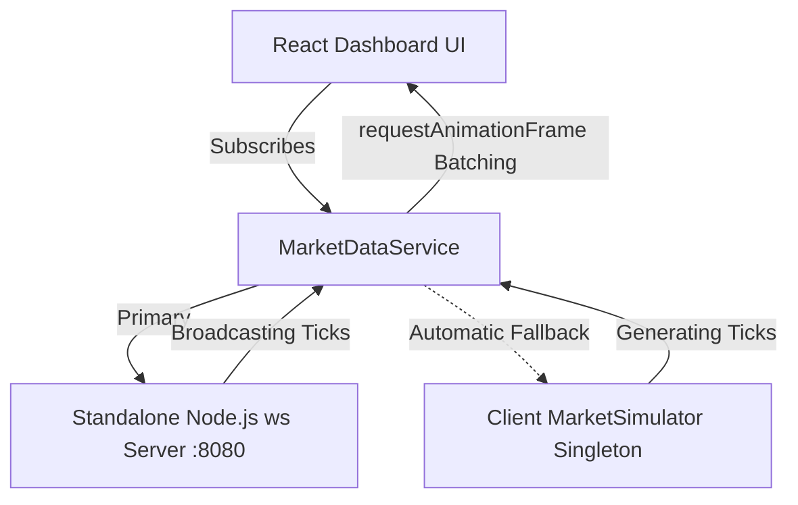

# PulseTrade — Real-Time Institutional Trading Dashboard

[](https://www.typescriptlang.org/)
[](https://react.dev/)
[](https://vitejs.dev/)
[](https://tradingview.github.io/lightweight-charts/)
[](https://vitest.dev/)

> **PulseTrade** is a high-performance, responsive real-time financial trading web terminal engineered with modern fintech standards (inspired by platforms like Nubra, TradingView, and Bloomberg Terminal). It showcases real-time market data streaming over WebSockets, sub-millisecond batched rendering, interactive financial candlestick charting, paper order execution simulation, and persistent client-side state.

---

> [!IMPORTANT]
> **SIMULATION NOTICE**: All market quotations, historical candles, order executions, and portfolio balances generated and displayed within PulseTrade are strictly simulated for educational and portfolio demonstration purposes. No connection to actual brokerage accounts or live exchange order routing is established.

---

## 🌟 Key Features

### 1. Header & Global Navigation
- **Live Brand Pulse**: Institutional dark branding with real-time heartbeat animation.
- **Global Securities Search**: Fast search across ticker symbols, company names, and market sectors with a quick-focus `/` keyboard shortcut.
- **Market Clock & Status**: Live session status (Continuous US Equities Session) with real-time EST clock.
- **WebSocket Connection Badge**: Real-time connection status (`connected`, `connecting`, `reconnecting`, `disconnected`, `error`), live roundtrip latency measurement (ping/pong), and manual retry actions.
- **Paper Equity Summary Pill**: Displays real-time portfolio equity and net P&L with direct modal inspection.

### 2. Market Pulse Overview
- **Breadth & Momentum**: Real-time counts of advancing (gaining) vs declining (falling) securities.
- **Top Performer & Top Decliner Cards**: Dynamic highlight cards that can be clicked to directly focus that security on the chart.
- **Aggregate 24h Volume**: Real-time cumulative market trading volume.

### 3. Interactive Financial Charting
- **TradingView Lightweight Charts v5**: High-performance canvas-based financial charting engine.
- **Multi-interval Selection**: 1D (5m candles), 1W (1h candles), 1M (daily), 3M (daily), and 1Y (daily).
- **Style Toggle**: Switch seamlessly between Candlestick and Area (Line) views.
- **Synchronized Volume Histogram**: Bottom volume bar pane matching candlestick bullish/bearish color states.
- **Dynamic Real-Time Candle Formation**: When incoming ticks arrive, the active candle updates its high, low, close, and volume live without re-rendering the full chart.
- **Interactive Crosshair Inspection**: Hover tooltip displays exact Timestamp, Open, High, Low, Close, and Volume.

### 4. Live Stock Watchlist
- **Seeded Equities**: Pre-populated with recognizable mega-cap tickers (`AAPL`, `MSFT`, `NVDA`, `AMZN`, `TSLA`, `GOOGL`, `META`, `AMD`, `NFLX`, `JPM`).
- **Interactive Sparklines**: Lightweight SVG trendlines with gradient fills indicating directional momentum.
- **Visual Price Flashing**: Instant green flash on uptick, red flash on downtick with automatic decay.
- **Sorting & Filtering**: Sort by Symbol, Current Price, 24h % Change, or Volume; filter inline.
- **Persistent LocalStorage**: Watchlist additions, removals, and ordering persist across browser sessions.
- **Quick-Add & Restore**: Easily add unselected securities or restore defaults with one click.

### 5. Stock Detail Panel
- **Comprehensive Key Metrics**: Day High, Day Low, Open, Previous Close, Volume, Market Cap, P/E Ratio, 52-Week Range.
- **Live Updating Ticks**: Immediate synchronization with incoming price events.
- **Watchlist Quick Toggle**: Bookmark or remove securities directly from the detail view.

### 6. Simulated Order Entry Ticket (Paper Trading)
- **Side Switching**: BUY / SELL side toggles with distinct contextual color treatments.
- **Order Types**: Market Orders (with realistic 0.05% slippage simulation) and Limit Orders (with custom limit price thresholds).
- **Quick Quantity Chips**: Single-click `+10`, `+25`, `+50`, `+100`, and `MAX` calculation based on available cash or owned positions.
- **Real-Time Validation**: Proactive validation preventing orders exceeding available cash or position holdings, invalid fractions, or zero/negative values.
- **Order Confirmation Modal**: Comprehensive pre-trade summary with estimated fees ($0.00 paper fee) and simulated risk warning.
- **Holdings & Order History Modal**: Interactive ledger tracking all executed simulated trades, average cost basis, current market values, and unrealized P&L.

---

## 🏗️ Architecture & Component Design

PulseTrade follows a decoupled clean architecture where data ingestion, simulation, and business logic remain strictly isolated from UI presentation:

```
src/
├── components/
│   ├── layout/
│   │   └── AppHeader.tsx         # Header, search, latency badge, paper equity pill
│   ├── market/
│   │   ├── MarketOverview.tsx    # Breadth metrics, top gainers & decliners
│   │   ├── Watchlist.tsx         # Watchlist table, sorting, quick add
│   │   ├── WatchlistRow.tsx      # Table row with flash animations & sparkline
│   │   ├── StockDetail.tsx       # Detail panel with OHLC and valuation metrics
│   │   └── Sparkline.tsx         # SVG sparkline with gradient fill
│   ├── charts/
│   │   ├── PriceChart.tsx        # TradingView Lightweight Charts integration
│   │   └── ChartControls.tsx     # Interval (1D-1Y) and style switches
│   ├── trading/
│   │   ├── OrderTicket.tsx       # Order entry form, validation, chips
│   │   ├── OrderConfirmationModal.tsx # Execution preview modal
│   │   └── PortfolioModal.tsx    # Paper positions & trade history ledger
│   └── ui/
│       ├── Button.tsx            # Accessible button component
│       ├── Modal.tsx             # Accessible dialog with escape & backdrop handlers
│       ├── SearchInput.tsx       # Global search input with '/' shortcut
│       ├── Skeleton.tsx          # Shimmer loading placeholders
│       └── StatusBadge.tsx       # WebSocket connection & latency pill
├── hooks/
│   ├── useMarketData.ts          # Market feed subscription & batched updates
│   ├── useWatchlist.ts           # Watchlist state, search, sort & storage
│   └── usePortfolio.ts           # Cash balance, order execution & live P&L
├── services/
│   ├── marketDataService.ts      # WebSocket connection lifecycle & backoff
│   ├── marketSimulator.ts        # Plausible tick generation engine
│   └── mockData.ts               # Seeded dataset & deterministic OHLCV candles
├── types/
│   ├── market.ts                 # Market ticks, stocks, WebSocket protocol types
│   └── orders.ts                 # Order ticket, trade ledger, portfolio types
├── utils/
│   ├── formatCurrency.ts         # Zero-NaN safe currency formatting
│   ├── formatPercentage.ts       # Percentage change formatters with signs
│   ├── formatNumber.ts           # Compact volume & market cap formatters
│   └── validation.ts             # Order ticket input & balance validation
└── tests/                        # 49 unit and component tests
```

---

## 📡 WebSocket Architecture & Fallback Mechanism

PulseTrade features a dual-layer resilient connection architecture:



1. **Standalone WebSocket Server (`server/simulatorServer.ts`)**:
   - Built with Node.js and the `ws` library.
   - Listens on `ws://localhost:8080`.
   - Sends initial snapshot on connection.
   - Supports subscription filtering (`subscribe`, `unsubscribe`, `ping/pong`).
   - Emits random walk price ticks with mean-reversion every 750ms.

2. **Resilient Client Simulator Fallback**:
   - If the standalone WebSocket server is stopped or unreachable, `MarketDataService` detects the disconnect and, after exponential backoff retries, seamlessly activates an internal in-browser simulation engine (`globalClientSimulator`).
   - When the standalone server is restarted, the client automatically re-establishes connection and resumes server streaming.

3. **Sub-Millisecond UI Batching**:
   - Rapid price ticks are queued and dispatched via `requestAnimationFrame` to ensure zero UI frame-drops and silky 60fps rendering.

---

## 🚀 Quick Start Guide

### Prerequisites
- **Node.js**: v18.0.0 or higher (v20+ recommended)
- **npm**: v9.0.0 or higher

### Installation

Clone the repository and install dependencies:

```bash
git clone https://github.com/your-username/PulseTrade.git
cd PulseTrade
npm install
```

### Environment Configuration

Copy the example environment file:

```bash
cp .env.example .env
```

Configuration options:
```env
# WebSocket endpoint for real-time market data feed
VITE_WS_URL=ws://localhost:8080

# Enable in-browser client fallback simulator if standalone server is unavailable
VITE_ENABLE_CLIENT_SIMULATOR_FALLBACK=true

# Market tick interval in milliseconds
VITE_TICK_INTERVAL_MS=800

# Market label
VITE_MARKET_NAME="PulseTrade Global Equities (Simulated)"
```

---

## 💻 Available Scripts

| Command | Description |
|---|---|
| `npm run dev` | **Runs both the frontend app and the standalone WebSocket server concurrently.** |
| `npm run dev:app` | Starts only the Vite frontend dev server (`http://localhost:5173`). In-browser simulator fallback activates automatically. |
| `npm run dev:server` | Starts only the standalone Node.js WebSocket simulator server (`ws://localhost:8080`). |
| `npm test` | Runs the full Vitest automated test suite (49 tests). |
| `npm run test:watch` | Runs Vitest in interactive watch mode. |
| `npm run build` | Compiles TypeScript and creates optimized production assets in `dist/`. |
| `npm run preview` | Locally previews the production build. |

---

## 🔌 Connecting a Real Market Data Provider

To connect a live production market data provider (such as Alpaca Markets, Polygon.io, Finnhub, or IEX Cloud):

1. **Implement Provider Adapter in `src/services/`**:
   Replace or wrap `MarketDataService` with your provider's WebSocket client:
   ```typescript
   // Example mapping live exchange ticks to PulseTrade tick schema:
   const liveTick: MarketTick = {
     symbol: externalMsg.sym,
     price: externalMsg.p,
     change: externalMsg.p - prevClose,
     changePercent: ((externalMsg.p - prevClose) / prevClose) * 100,
     volume: externalMsg.v,
     high: externalMsg.h,
     low: externalMsg.l,
     timestamp: externalMsg.t,
   };
   ```

2. **Update Environment Endpoint**:
   Update `VITE_WS_URL` in `.env` with your secure WebSocket endpoint (`wss://socket.polygon.io/stocks` or similar).

---

## 🧪 Testing Suite

PulseTrade includes a comprehensive test suite written with **Vitest** and **React Testing Library**:

- **Currency & Percentage Formatting**: Zero-NaN guarantees, sign formatting, compact notation (`1.5M`, `2.4B`), and invalid input resilience.
- **Order Ticket Validation**: Quantity constraints, fractional limits, limit price rules, cash sufficiency checks for BUY, and share ownership constraints for SELL.
- **Market Simulator & OHLCV Mathematics**: Tests tick generation, event dispatch, and verifies historical candle invariants (`high >= max(open, close)`, `low <= min(open, close)`).
- **Watchlist Persistence & Search**: LocalStorage synchronization, symbol addition, duplicate rejection, and search/sort operations.
- **WebSocket Protocol Parsing**: Tests `snapshot`, `tick`, `batch_ticks`, and ping/pong roundtrip latency calculation.
- **Component Tests**: StatusBadge states, OrderTicket interactions, Watchlist rendering, and empty state fallbacks.

Run tests:
```bash
npm test
```

---

## 🛡️ License

This project is created under the MIT License as an open-source frontend engineering portfolio showcase.
